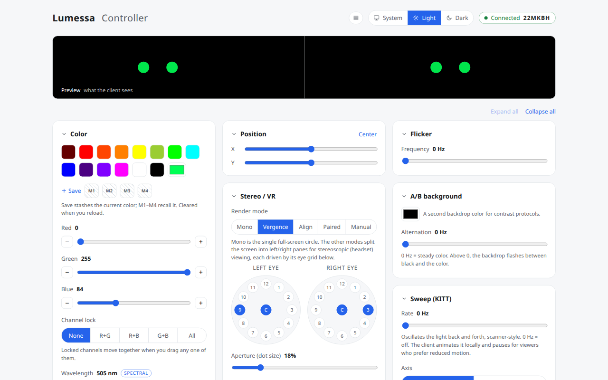
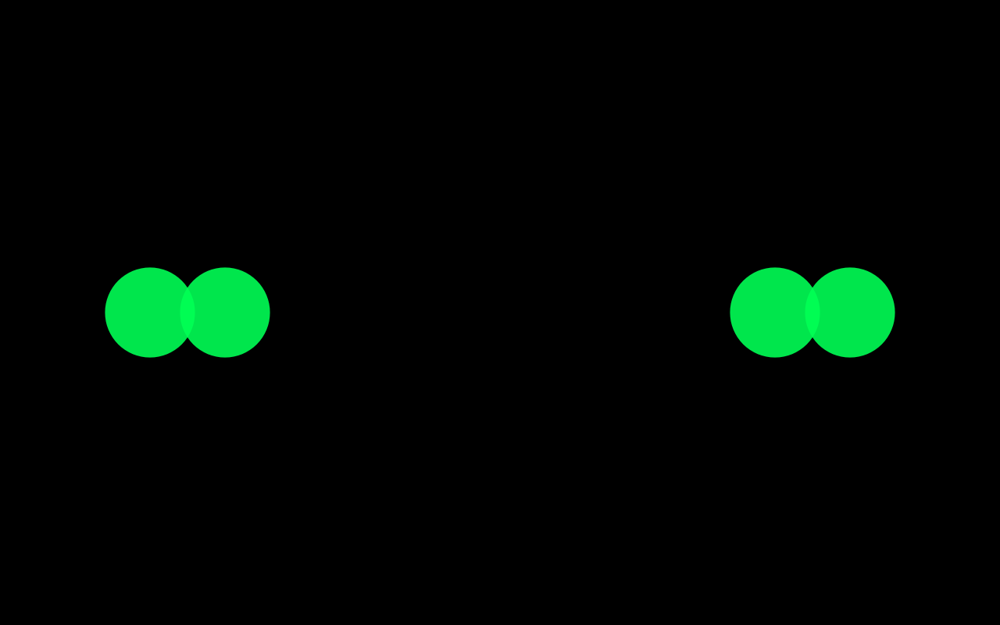

<h1 align="center">Lumessa</h1>

<p align="center">
  Realtime light-stimulus control for a phone-in-a-headset display.
  <br />
  <a href="https://app.lumessa.xyz"><strong>Controller</strong></a> ·
  <a href="https://join.lumessa.xyz"><strong>Client</strong></a> ·
  <a href="docs/architecture.md">Architecture</a> ·
  <a href="docs/protocol.md">Protocol</a> ·
  <a href="docs/roadmap.md">Roadmap</a>
</p>

<p align="center">
  <a href="https://github.com/Kombuchelada/lights/actions/workflows/ci.yml"></a>
  
  
  
  
</p>

<picture>
  <source media="(prefers-color-scheme: dark)" srcset="docs/assets/controller-dark.png" />
  
</picture>

A clinician uses the **controller** to drive a colored light on a **client** screen:
a phone in a Cardboard-style headset, or any browser. Every change reaches the
client in realtime, and the controller confirms when it has rendered.

> [!WARNING]
> Lumessa can flash the screen. Flashing light can trigger seizures in people with
> photosensitive epilepsy. Flicker and background alternation are clamped, flagged
> in the high-risk 15–25 Hz band, and only render after the person at the client
> gives explicit consent. **Lumessa is not a medical device.**

## Features

- **Color**: RGB sliders with ±1 fine steps, channel lock, 14 presets, a custom
  picker, four in-session memory slots, and spectral color by wavelength
  (380–780 nm).
- **Light**: brightness, size, and X/Y position, using normalized geometry so the
  same state renders the same way on any screen.
- **Stereo / VR**: a dual-pane renderer with per-eye 13-point clock-grid
  targeting. Modes are vergence, align, paired, and manual. Each eye has its own
  rotation, and there are controls for aperture and eye distance.
- **Temporal stimuli**: flicker, an A/B alternating background, and a sweep that
  oscillates the light along one axis. The client animates all three locally, so
  timing doesn't depend on the network.
- **Pairing**: start a session, then join it from the client with a 6-character
  code, a QR code (the client can scan it with its own camera), or a link.
- **Controller UX**: light, dark, and system themes, a compact view, collapsible
  cards with live summaries, and a sticky live preview. It is keyboard-operable
  and meets WCAG AA ([audit](docs/accessibility.md)).
- **Client**: an installable PWA that paints pure black around the light, with
  Screen Wake Lock, tap-to-fullscreen, and reconnect on refresh.

<p align="center">
  
</p>

## How it works

```
 Controller (Angular)                         Client (Vite PWA)
  ─ authenticates (Auth0)                      ─ joins anonymously by code
  ─ POST /api/sessions → code + QR             ─ renders state on a canvas
          │                                              ▲
          │ SendState(LightState)        ReceiveState    │
          ▼                                              │
        ┌──────────────────────────────────────────────────┐
        │ ASP.NET Core · SignalR /hubs/control              │
        │ validates + clamps every state · relays per group │
        │ keeps the last state to resync rejoining clients  │
        └──────────────────────────────────────────────────┘
```

Clients receive the stimulus as declarative **state**, never per-frame commands.
The server is authoritative: every `LightState` passes through
`ProtocolLimits.Sanitize`. The wire contract is versioned, and `v2` is a strict
superset of `v1`. See [`docs/protocol.md`](docs/protocol.md).

| Path | What it is |
|---|---|
| [`server/`](server) | ASP.NET Core (.NET 10) minimal API + SignalR hub. `Lumessa.Core` holds the domain (DTOs, limits, sessions, wavelength); `Lumessa.Api.Tests` holds the xUnit tests. |
| [`apps/management/`](apps/management) | The controller: Angular 21, zoneless and signal-based, using token-based SCSS ([design system](docs/design-system.md)). |
| [`apps/client/`](apps/client) | The client: vanilla TypeScript + Vite PWA with a canvas renderer. |
| [`packages/protocol/`](packages/protocol) | Shared TypeScript protocol types and limits, mirroring the C# DTOs. The apps consume it through a path alias, so it needs no build step. |
| [`docs/`](docs) | Architecture, protocol, roadmap, testing, deployment, and ADRs. |

## Getting started

**Prerequisites:** Node.js 22 or later, and the .NET 10 SDK.

```bash
# Server: http://localhost:5000
cd server && dotnet run --project Lumessa.Api

# Controller: http://localhost:4200
cd apps/management && npm install && npm start

# Client: http://localhost:5173
cd apps/client && npm install && npm run dev
```

Both front-ends proxy `/api` and `/hubs` to the server. In the controller, click
**Start session**, then open the client and enter the code. Authentication turns
itself off when Auth0 isn't configured, so local development needs no account.

To test on a real phone (camera scanning, fullscreen, wake lock, and PWA install
all need HTTPS), see [`docs/testing.md`](docs/testing.md).

### Tests

```bash
dotnet test server/Lumessa.sln                 # server
cd apps/management && npm test -- --watch=false  # controller unit tests
cd apps/management && npm run lint:css           # design-token lint
cd apps/client && npm run build                  # client typecheck + build
```

CI runs all of these on every push and pull request.

## Deployment

Production runs on [Railway](https://railway.com) as three services. Two Caddy
front-ends proxy `/api` and `/hubs` over private networking to the private API
service. Pushes to `main` deploy automatically. See
[`docs/deployment.md`](docs/deployment.md) and
[ADR 0001](docs/adr/0001-hosting-on-railway.md).

| Service | URL |
|---|---|
| Controller | <https://app.lumessa.xyz> |
| Client | <https://join.lumessa.xyz> |
| Auth | Auth0 at `login.lumessa.xyz` ([details](docs/auth0.md)) |

## Documentation

| Doc | Covers |
|---|---|
| [Architecture](docs/architecture.md) | Components, pairing and session lifecycle, design principles |
| [Protocol](docs/protocol.md) | The hub methods and events, `LightState`, limits, and versioning |
| [Roadmap](docs/roadmap.md) | What's built, what's next, and what's deferred |
| [Testing](docs/testing.md) | HTTPS/LAN setup for real devices and the manual test scripts |
| [Accessibility](docs/accessibility.md) | The audit findings and the a11y checklist |
| [Design system](docs/design-system.md) | Controller tokens and how stylelint enforces them |
| [Authentication](docs/auth0.md) | The Auth0 setup and the controller/client trust split |
| [Glossary](CONTEXT.md) | Domain vocabulary |

## Security

Report vulnerabilities privately; see [`SECURITY.md`](SECURITY.md).

## License

Copyright © 2026 Daniel Lynch. All rights reserved. The source is public for
reference only and grants no license to use, copy, modify, or distribute it. See
[`LICENSE`](LICENSE).
